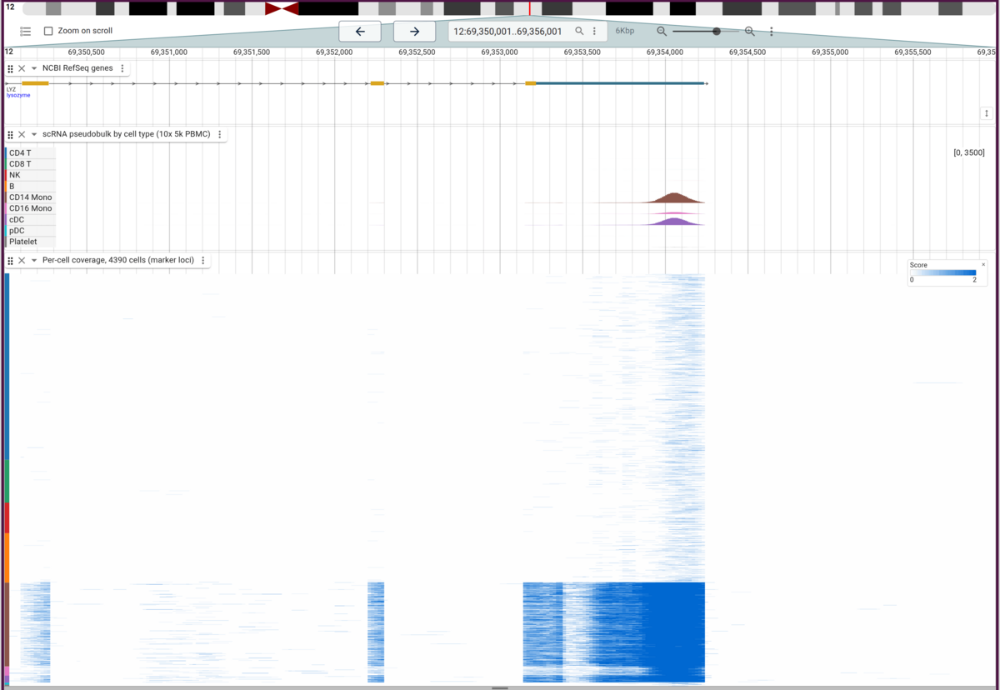

# jbrowse-plugin-zarr

Reads multi-sample quantitative signal from a [Zarr v3](https://zarr.dev/) store
into a JBrowse 2
[`MultiQuantitativeTrack`](https://jbrowse.org/jb2/docs/user_guides/multiquantitative_track).
It reads stores written for it, described by a `jbrowse_signal_matrix` metadata
object, not Zarr in general.

<table>
  <tr>
    <td width="50%"></td>
    <td width="50%"></td>
  </tr>
  <tr>
    <td>Copy number for the 2,504-sample 1000 Genomes panel over CCL3L1: three requests for the screen. <a href="docs/benchmarks.md#copy-number-2504-samples">Data and credit</a></td>
    <td>Per-cell coverage for 4,390 PBMCs over LYZ, one row per cell, grouped by cell type. <a href="https://jbrowse.org/jb2-staging/docs/tutorials/scrna_pseudobulk/">Tutorial</a></td>
  </tr>
</table>

One BigWig per sample costs three to four sequential requests per sample. Here
every sample sits in one array, so a screen is a handful of chunk reads straight
off static hosting, with no tile server. Resolution levels carry min and max
beside the mean, and sample names, colors and groups come from the store.

## Install

Needs JBrowse 5. Install `Zarr` from the
[plugin store](https://jbrowse.org/jb2/docs/user_guides/plugin_store), or name it
in a config:

```json
{
  "plugins": [{ "storePlugin": "Zarr" }],
  "tracks": [
    {
      "type": "MultiQuantitativeTrack",
      "trackId": "cohort_signal",
      "name": "Cohort signal",
      "assemblyNames": ["hg38"],
      "adapter": {
        "type": "MultiWiggleZarrAdapter",
        "uri": "https://example.com/cohort.zarr"
      },
      "displayDefaults": { "defaultRendering": "multirowdensity" }
    }
  ]
}
```

The adapter config is the store's location; everything else comes from the
store's metadata.

## Docs

- [Store format](docs/store-format.md): metadata, chunk layout, summary levels,
  size, codecs, and ideas not done yet such as sharding
- [Benchmarks](docs/benchmarks.md): a worked example on the 1000 Genomes panel,
  and requests, bytes and time against BigWigs and a bedGraph
- [Comparison](docs/comparison.md): when to use a bedGraph, BigWigs or figwig
  instead
- [Development](docs/development.md): building, testing and releasing
