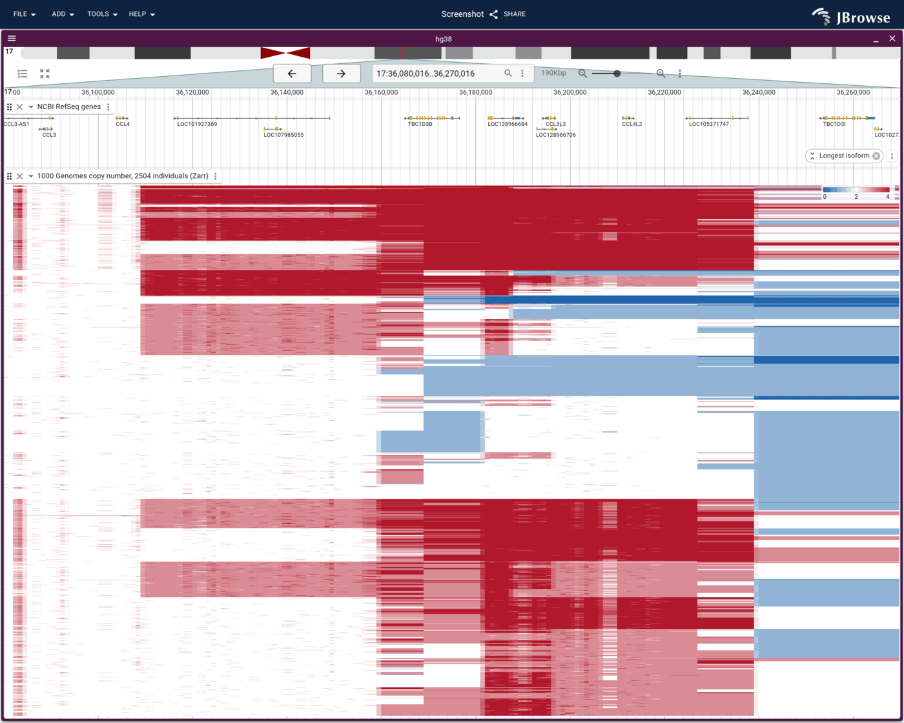

# jbrowse-plugin-zarr

Reads multi-sample quantitative signal from a [Zarr v3](https://zarr.dev/) store
into a JBrowse 2
[`MultiQuantitativeTrack`](https://jbrowse.org/jb2/docs/user_guides/multiquantitative_track).
The store holds one samples-by-bins array per resolution level, described by a
`jbrowse_signal_matrix` metadata object, so this reads stores written for it
rather than Zarr in general.



Every individual in the 1000 Genomes panel over the CCL3L1 locus, one row each,
clustered so the copy-number classes separate. White is two copies, red a gain,
blue a loss. The whole screen is three requests against one store. Built in
[Population copy number with the 1000 Genomes panel](https://jbrowse.org/jb2-staging/docs/tutorials/population_cnv/),
this adapter's worked example, which also covers writing the store.

The copy-number values are not ours. They are
[QuicK-mer2](https://github.com/KiddLab/QuicK-mer2) estimates over the 30x 1000
Genomes panel, produced by the Kidd lab at the University of Michigan and
published as the [KiddLab/kmer_1KG](https://github.com/KiddLab/kmer_1KG) track
hub. If you use them, cite Shen F and Kidd JM,
[Rapid, Paralog-Sensitive CNV Analysis of 2457 Human Genomes Using QuicK-mer2](https://doi.org/10.3390/genes11020141),
Genes 2020, 11(2):141.

## Why

A multi-sample track built from one BigWig per sample is bound by round trips,
not bytes: each file needs its header and indexes before it knows where a
region's values live, so a screen costs three to four sequential requests per
sample. At 2,500 samples that is thousands of requests for a few kilobytes.

A samples-by-bins array chunked `[all samples, N bins]` answers the same screen
in one or two chunk reads, whatever the sample count, straight off static
hosting with no tile server.

Use it for per-base signal across many samples, for genome-wide views of a large
cohort, or when min and max [summary levels](docs/store-format.md#summary-levels)
matter at coarse zoom. For binned data viewed at a locus, a multi-column
bedGraph is simpler and smaller; see the
[comparison](docs/comparison.md).

## Features

Zoom levels:

- A store holds a resolution pyramid, one array per level, each with its own bin
  size.
- The adapter reads the coarsest level whose bins are no wider than a screen
  pixel, so wide views stop growing: 46 requests at 100 kb and at 10 Mb in the
  [per-base benchmark](docs/benchmarks.md#per-base-signal-100-samples).
- A level can carry min and max arrays beside its mean, as a BigWig zoom record
  does, so narrow features survive zooming out.
- Switching between mean, min and max redraws without a refetch.

Capabilities:

- A screen is a handful of chunk reads, whatever the sample count.
- Multi-region and whole-genome views merge into as few reads as the layout
  allows.
- Unmeasured bins stay empty rather than drawing as zero.
- Sample names, colors and group attributes come from the store, for coloring,
  grouping and filtering rows.
- Clustering reads the store through the display's score-matrix path.
- Needs only static hosting: any server that answers range requests.

Not done yet, but something Zarr can do:

- [Sharding](docs/store-format.md#ideas-not-done-yet) to cut object counts, and
  sample-grouped chunks with row-only reads for stores where people show a few
  samples out of thousands.

## Install

Needs JBrowse 5. Install it from the
[plugin store](https://jbrowse.org/jb2/docs/user_guides/plugin_store), or name
it in a config by its store name, which resolves to the newest release the host
supports (see
[configuring plugins](https://jbrowse.org/jb2/docs/config_guides/plugins)):

```json
{
  "plugins": [{ "storePlugin": "Zarr" }],
  "tracks": [
    {
      "type": "MultiQuantitativeTrack",
      "trackId": "cohort_signal",
      "name": "Cohort signal",
      "assemblyNames": ["hg38"],
      "adapter": {
        "type": "MultiWiggleZarrAdapter",
        "uri": "https://example.com/cohort.zarr"
      },
      "displayDefaults": { "defaultRendering": "multirowdensity" }
    }
  ]
}
```

The adapter config is the store's location and nothing else. Sample names, bin
size and resolution levels come from the store's own metadata.

## The store

A Zarr v3 group with a `jbrowse_signal_matrix` attribute and one `float32`
`[samples, bins]` array per resolution level, chunked with the whole sample axis
in one chunk. Write one with
[`build_signal_zarr.ts`](https://github.com/GMOD/jbrowse-components/blob/main/scripts/build_signal_zarr.ts),
which packs a list of BigWigs into this layout. Metadata, summary levels, size
and codecs are in [docs/store-format.md](docs/store-format.md).

## Docs

- [Store format](docs/store-format.md): metadata, chunk layout, summary levels,
  size and codecs
- [Benchmarks](docs/benchmarks.md): requests, bytes and time against BigWigs and
  a multi-column bedGraph
- [Comparison](docs/comparison.md): when to use a bedGraph, BigWigs or figwig
  instead
- [Development](docs/development.md): building, testing and releasing
