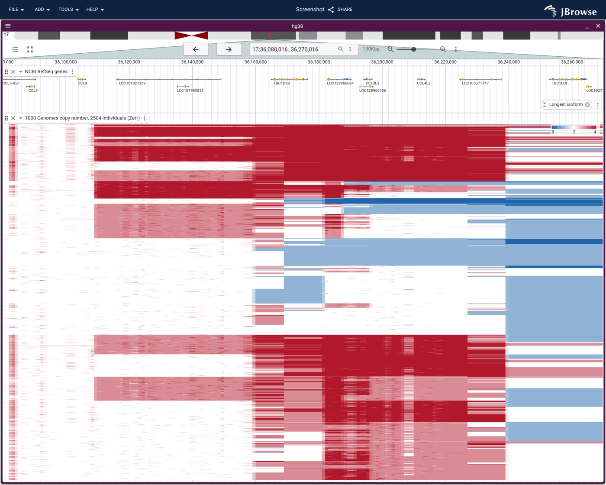

# Benchmarks

Measured with [jb2bench](https://github.com/cmdcolin/jb2bench), scripts in
`scripts/cohort-signal/`. Each table compares one BigWig per sample, this store,
and a Tabix-indexed bedGraph with one value column per sample (read with
JBrowse's built-in `BedGraphTabixAdapter`).

## Copy number, 2,504 samples

Every individual in the 1000 Genomes panel over the CCL3L1 locus, one row each,
clustered so the copy-number classes separate. White is two copies, red a gain,
blue a loss. The whole screen is three requests against one store. Built in
[Population copy number with the 1000 Genomes panel](https://jbrowse.org/jb2-staging/docs/tutorials/population_cnv/),
this adapter's worked example, which also covers writing the store.

The copy-number values are not ours. They are
[QuicK-mer2](https://github.com/KiddLab/QuicK-mer2) estimates over the 30x 1000
Genomes panel, produced by the Kidd lab at the University of Michigan and
published as the [KiddLab/kmer_1KG](https://github.com/KiddLab/kmer_1KG) track
hub. If you use them, cite Shen F and Kidd JM,
[Rapid, Paralog-Sensitive CNV Analysis of 2457 Human Genomes Using QuicK-mer2](https://doi.org/10.3390/genes11020141),
Genes 2020, 11(2):141.

Timings on the same panel. Copy number changes slowly and repeats
across samples, so one bedGraph row covers a long stretch.

| view                   | 2,504 BigWigs                | this store                  | multi-column bedGraph       |
| ---------------------- | ---------------------------- | --------------------------- | --------------------------- |
| 190 kb of chr17        | 15,048 requests, 48 MB, 14 s | 3 requests, 0.19 MB, 0.06 s | 3 requests, 0.31 MB, 0.08 s |
| all of chr17, 1,500 px | 15,048 requests, 69 MB, 15 s | 40 requests, 9.5 MB, 0.5 s  | 4 requests, 5.9 MB, 1.1 s   |

At a locus the two single-file layouts are the same. The store is ahead only
when zoomed out: a bedGraph has one bin size, so a whole-chromosome view returns
every row, and parsing that text is most of its 1.1 s.

## Per-base signal, 100 samples

100 ENCODE ATAC-seq fold-change tracks over chr1:10-20 Mb at native resolution
(`SET=perbase`).

| view   | 100 BigWigs                 | this store                 | multi-column bedGraph       |
| ------ | --------------------------- | -------------------------- | --------------------------- |
| 1 kb   | 692 requests, 2.3 MB, 0.9 s | 7 requests, 0.05 MB, 0.1 s | 3 requests, 1.0 MB, 0.2 s   |
| 100 kb | 674 requests, 5.8 MB, 0.9 s | 46 requests, 2.1 MB, 0.2 s | 4 requests, 6.5 MB, 1.5 s   |
| 1 Mb   | 600 requests, 5.2 MB, 1.0 s | 46 requests, 2.4 MB, 0.4 s | 14 requests, 51 MB, 11 s    |
| 10 Mb  | 600 requests, 3.2 MB, 0.9 s | 46 requests, 2.1 MB, 0.2 s | 111 requests, 502 MB, 109 s |

A hundred samples rarely share a value at adjacent bases, so the bedGraph keeps
9.0 million rows for 10 million bases after merging equal ones, and every view
reads all of them. The store reads a coarser level instead. The BigWigs have
zoom levels too and hold near 1 s, at 600-700 requests a screen.

## Size on disk

For the per-base set above:

| format                | size   |
| --------------------- | ------ |
| this store            | 1.0 GB |
| 100 BigWigs           | 634 MB |
| multi-column bedGraph | 495 MB |

The store's 10 bp level with min and max is 390 MB of that, more than the 1 bp
level, so start the pyramid coarser if disk matters more than views around
10-50 kb.

For the whole-genome copy-number panel the store is 662 MB against 178 MB for the
bedGraph.
